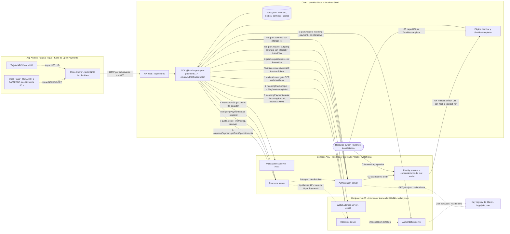
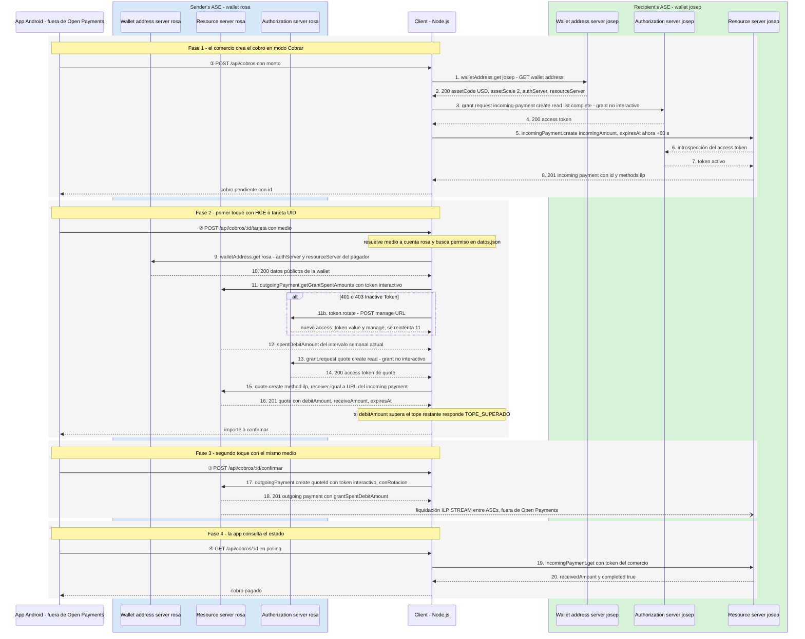
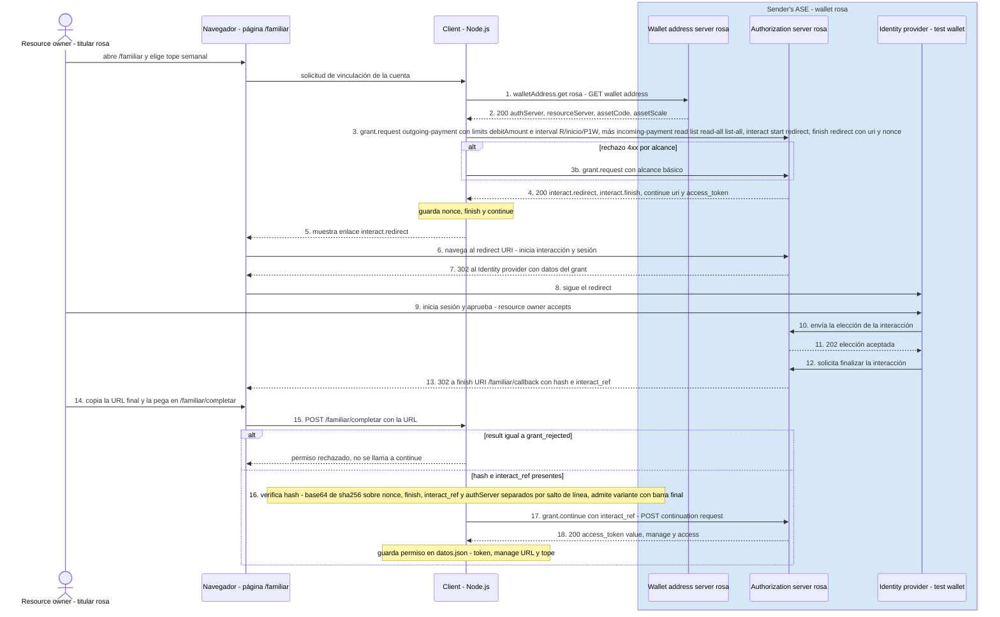

# Pago al Toque encaja en Open Payments

En la terminología oficial de Open Payments, **Pago al Toque es un único Client (el servidor Node.js) que actúa entre dos roles de Account servicing entity: el sender's ASE (la wallet del pagador, "rosa") y el recipient's ASE (la wallet del comercio, "josep")**. La app Android queda fuera de la frontera de Open Payments: es un front end propio que captura toques NFC y le pide cosas al Client por HTTP. Cada cobro sigue el "Path 1" oficial (incoming payment en el recipient's ASE, quote y outgoing payment en el sender's ASE), con una diferencia que la documentación prevé. El grant interactivo de outgoing payment no se pide en cada cobro. Se obtiene una sola vez, con un límite semanal (`limits.debitAmount` + `interval: R/…/P1W`), y se reutiliza en cada cobro posterior, igual que en las guías oficiales de pagos recurrentes y futuros. Ambos roles de ASE los cumple la misma instancia de Rafiki detrás del Interledger test wallet (`ilp.interledger-test.dev`). En el diagrama son cajas separadas porque así lo modela la documentación y porque cada wallet address tiene su propio Authorization server y Resource server. La implementación es coherente con los flujos oficiales. Los riesgos están en los bordes del protocolo: el hash de interacción, la revocación de tokens, la ventana de 60 s y el control de estado del incoming payment.

## Tres actores oficiales y una app que queda fuera de la frontera

Open Payments define tres actores. El primero es el **Client**: "an application, such as a mobile or web app, that consumes one or more Open Payments resources" ([Getting started](https://openpayments.dev/overview/getting-started/)). El segundo es el **Resource owner (RO)**, que emite el grant. El tercero es la **Account servicing entity (ASE)**, que "provides and maintains a payment account for a sender and recipient" ([Glossary](https://openpayments.dev/resources/glossary/)). Cada ASE "must operate three servers and integrate with an identity provider": un **Wallet address server**, un **Resource server** (incoming payment, quote, outgoing payment) y un **Authorization server** (grants GNAP y access tokens), además de la integración con un **Identity provider** que autentica al RO y recoge su consentimiento ([ASE overview](https://openpayments.dev/implement/ase-overview/)). Open Payments solo transporta la instrucción de pago: **el dinero lo mueve la ASE**, y entre ASEs se liquida por un riel compartido, que hoy es solo ILP ([Payments](https://openpayments.dev/concepts/payments/)).

La documentación pone como ejemplo de Client una app móvil. Aun así, en Pago al Toque el Client formal es el **servidor Node.js**, porque es el único que tiene la clave Ed25519 (`private.key`) y el `keyId`. También es el que firma cada petición con HTTP Message Signatures. El Authorization server valida esa firma descargando `jwks.json` de la wallet address del propio Client (`https://ilp.interledger-test.dev/app`), no de la del pagador ni de la del comercio ([Client keys](https://openpayments.dev/identity/client-keys/)). La app Android (modos Cobrar/Pagar, HCE con AID `F0 "DATAFONO"`, tarjetas por UID) no firma nada ni tiene tokens. Por eso queda fuera de la frontera Open Payments. El host `https://ilp.interledger-test.dev` aparece como servidor en la especificación OpenAPI del Resource server ([resource-server.yaml](https://github.com/interledger/open-payments-specifications/blob/main/openapi/resource-server.yaml)). Rafiki implementa el Authorization server con su servicio *auth* y el Resource server con su *backend* ([Rafiki: Open Payments](https://rafiki.dev/overview/concepts/open-payments/)).

| Actor oficial | Componente en Pago al Toque |
|---|---|
| Client | Servidor Node.js, Express 5, `@interledger/open-payments` 7.4, `createAuthenticatedClient` con wallet `/app` |
| Resource owner | Titular de la wallet del pagador ("rosa"), que aprueba en el test wallet |
| Sender's ASE | Test wallet / Rafiki para `https://ilp.interledger-test.dev/rosa` (USD, assetScale 2) |
| Recipient's ASE | Test wallet / Rafiki para `https://ilp.interledger-test.dev/josep` |
| Identity provider | Pantalla de login y consentimiento del Interledger test wallet |
| Fuera de Open Payments | App Android (Cobrar, Pagar con HCE, tarjetas NFC) y `datos.json` |

### Diagrama 1: componentes sobre los actores oficiales

Los números 1–9 son las llamadas de un cobro. G1–G6 son la aprobación única del grant interactivo. Las líneas discontinuas indican tráfico interno de la ASE o fuera de Open Payments.

## Un cobro recorre el Path 1 con el grant interactivo ya guardado

El flujo oficial de extremo a extremo tiene cinco pasos. Primero se obtienen los datos de la wallet address. Después se pide un grant **no interactivo** `incoming-payment` al Authorization server del **recipient** y se crea el incoming payment en su Resource server. Luego, un grant **no interactivo** `quote` y la creación del quote en el **sender's ASE**. Después, un grant **interactivo** `outgoing-payment` y el outgoing payment, también en el sender's ASE. Por último, la consulta opcional de historial ([Open Payments flow](https://openpayments.dev/concepts/op-flow/)). El diagrama oficial "Bringing it all together" agrupa los participantes en una caja **sender's ASE** (IdP, RS, AS) y otra **recipient's ASE** (wallet address URL, AS, RS), con el **Client fuera de ambas**. El diagrama 2 conserva esa estructura.

Pago al Toque saca el bloque interactivo del cobro. La guía de suscripciones recurrentes lo dice explícitamente: en cada intervalo se repiten solo incoming payment, quote y outgoing payment, porque "You don't need to request new grants because the original grants should be valid for the remaining billing periods" ([Recurring subscription](https://openpayments.dev/guides/recurring-subscription-incoming-amount/)). La guía "outgoing grant for future payments" cubre justo el caso de autorizar gasto **sin conocer al receptor de antemano**, con un `debitAmount` por intervalo ([Future payments](https://openpayments.dev/guides/outgoing-grant-future-payments/)). Ninguna guía oficial trata un POS o pago presencial, así que esta combinación es la más cercana documentada.

Hay dos detalles que el diagrama refleja. El primero es el quote. Como el incoming payment ya trae `incomingAmount`, el quote se crea con la variante "Receiver with incoming amount" (`method: "ilp"` + `receiver`, sin importe), que es la exigida por la especificación cuando el receptor fija el importe ([resource-server.yaml](https://github.com/interledger/open-payments-specifications/blob/main/openapi/resource-server.yaml)). El `quote.debitAmount` que devuelve es el coste real, comisiones incluidas, y es lo que se compara con el tope restante. El segundo es el saldo del límite. `GET /outgoing-payment-grant` (`getGrantSpentAmounts`) devuelve `spentDebitAmount` **solo para el intervalo actual**, y puede venir `null` ([Spent amounts SDK](https://openpayments.dev/sdk/outgoing-grant-spent-amounts/)). El cálculo correcto es `tope − (spentDebitAmount ?? 0)`.

### Diagrama 2: un cobro de extremo a extremo

Los números ①–④ son las fases de nuestra API. Los números 1–20 son las llamadas Open Payments.

## La aprobación única replica el diagrama oficial del Identity provider

El grant `outgoing-payment` es **siempre interactivo**: "Open Payments requires outgoing payment grant requests to be interactive", y después de la interacción el Client tiene que enviar un Grant Continuation request ([Authorization](https://openpayments.dev/concepts/auth/)). La secuencia oficial es la siguiente ([Identity providers](https://openpayments.dev/identity/idp/)):

1. El Client envía el grant request con el objeto `interact`.
2. El Authorization server devuelve el redirect URI y el continue URI.
3. El navegador va al Authorization server, que responde con un 302 al IdP.
4. El RO acepta en el IdP.
5. El IdP comunica la elección y el Authorization server responde 202.
6. Un 302 envía al finish URI con `hash` e `interact_ref`.
7. El Client verifica el hash.
8. El Client envía `POST` al continue URI con `interact_ref` y recibe el access token.

Open Payments solo admite `start: ["redirect"]` y `finish.method: "redirect"` ([auth-server.yaml](https://raw.githubusercontent.com/interledger/open-payments-specifications/main/openapi/auth-server.yaml)). Nuestra petición usa exactamente eso.

Nuestro grant pide `outgoing-payment` con las acciones `create, read, list, read-all, list-all`, con `identifier` igual a la wallet del pagador (obligatorio en el esquema `access-outgoing`) y `limits: { debitAmount: tope, interval: "R/<inicio>/P1W" }`. El `interval` es un "ISO8601 repeating interval" y los importes "are maxima" por intervalo, sin arrastre de lo no gastado ([auth-server.yaml](https://raw.githubusercontent.com/interledger/open-payments-specifications/main/openapi/auth-server.yaml); [Future payments](https://openpayments.dev/guides/outgoing-grant-future-payments/)). Los ejemplos oficiales solo usan `P1D` y `P1M`. El valor `P1W` se deduce de ISO 8601, no aparece en ningún ejemplo. Añadir `incoming-payment` con `list-all` dentro de este grant interactivo es correcto: Rafiki exige interacción para `list-all` por defecto (`LIST_ALL_ACCESS_INTERACTION=true`) ([Rafiki auth config](https://raw.githubusercontent.com/interledger/rafiki/main/packages/auth/src/config/app.ts)). La caída a un alcance básico ante un 4xx es una defensa razonable.

El único paso propio, sin equivalente en el diagrama oficial, es el puente manual. El finish URI apunta a `http://localhost:3000/familiar/callback`, que solo resuelve en la máquina del servidor. Por eso el titular pega la URL resultante en `/familiar/completar`. Para el protocolo es indiferente: el Client recibe los mismos `hash` e `interact_ref`.

### Diagrama 3: aprobación del grant interactivo, una sola vez

## Coherencia con la documentación

La implementación coincide con la documentación en estos puntos:

- **Actores.** El Client firmante está en el servidor y las ASE tienen sus roles separados ([Client keys](https://openpayments.dev/identity/client-keys/)).
- **Grants.** Los de incoming payment y quote son no interactivos; el de outgoing payment es interactivo ([Authorization](https://openpayments.dev/concepts/auth/)).
- **Orden de recursos.** Incoming payment en el recipient's ASE; quote y outgoing payment en el sender's ASE ([Open Payments flow](https://openpayments.dev/concepts/op-flow/)).
- **Grant reutilizable.** Lleva `limits` e `interval` ([Recurring subscription](https://openpayments.dev/guides/recurring-subscription-incoming-amount/)).
- **Rotación.** Se rota con `token.rotate` sobre la manage URL ([Rotate token](https://openpayments.dev/sdk/token-rotate/)).
- **Detección del pago.** Se hace por polling, que es el único mecanismo para un Client externo, porque los webhooks de Rafiki van a la ASE ([Rafiki webhooks](https://rafiki.dev/integration/requirements/webhook-events/)).

Los riesgos que señalan las notas, en orden de prioridad:

| Riesgo | Qué dice la fuente | Acción sugerida |
|---|---|---|
| Codificación del hash | La documentación dice "Base64 with no padding"; RFC 9635 exige base64 URL-safe sin padding; el ejemplo de la documentación y Rafiki usan `digest('base64')` estándar con `=` ([Hash verification](https://openpayments.dev/identity/hash-verification/); [RFC 9635](https://www.rfc-editor.org/rfc/rfc9635); [Rafiki routes](https://raw.githubusercontent.com/interledger/rafiki/main/packages/auth/src/interaction/routes.ts)) | Normalizar los dos lados (`-_`→`+/`, quitar `=`) antes de comparar, con comparación de tiempo constante. Leer `hash` con `URLSearchParams` para que `+` no se convierta en espacio |
| `result=grant_invalid` | Rafiki lo devuelve si la interacción no se aprobó ni se rechazó ([Rafiki routes](https://raw.githubusercontent.com/interledger/rafiki/main/packages/auth/src/interaction/routes.ts)) | Ya cubierto: `completarPermiso` trata cualquier `result` como fallo y no llama a continue |
| "Inactive Token" también significa revocado | El Resource server responde 403 "Inactive Token" si el token no está activo, sea por caducidad (600 s por defecto) o por revocación ([Rafiki middleware](https://raw.githubusercontent.com/interledger/rafiki/main/packages/backend/src/open_payments/auth/middleware.ts)) | Si `token.rotate` falla (`invalid_rotation`/401), invalidar el permiso y pedir un grant nuevo, sin reintentar en bucle |
| Rotación concurrente | La rotación invalida el valor anterior ([RFC 9635](https://www.rfc-editor.org/rfc/rfc9635)) | `conRotacion` ya persiste el nuevo `value` y `manage`; falta rotar en single-flight por permiso |
| No se guarda el nuevo `continue` | La respuesta de continuation trae un `continue` nuevo, que hace falta para `grant.cancel` ([Future payments](https://openpayments.dev/guides/outgoing-grant-future-payments/); [Grant revoke](https://openpayments.dev/sdk/grant-revoke/)) | Guardar `continue.uri` y `continue.access_token` para poder desvincular. Leer también el `access` concedido, que puede diferir del pedido |
| `expiresAt` de 60 s | Pasado `expiresAt`, la ASE "MUST reject any further payments"; el ejemplo del SDK usa 10 minutos ([resource-server.yaml](https://github.com/interledger/open-payments-specifications/blob/main/openapi/resource-server.yaml)) | Los 60 s tienen que cubrir los dos toques **y** el envío ILP, no solo la creación del outgoing payment. Comprobar también `quote.expiresAt` antes de confirmar |
| GET de incoming payment sin autenticar | La vista `public-incoming-payment` solo trae `receivedAmount` y `authServer`, sin `completed` ([resource-server.yaml](https://github.com/interledger/open-payments-specifications/blob/main/openapi/resource-server.yaml)) | Mantener el GET autenticado con el token del comercio. Si alguna vez se usa la vista pública, comparar con el `incomingAmount` guardado |
| Outgoing payment sin quote | La spec 1.4.0 permite `incomingPayment` + `debitAmount` sin quote ([Resources](https://openpayments.dev/concepts/resources/)) | No usarlo: sin quote no se conoce el coste real antes de compararlo con el tope |
| `cardAuthorization` | Propiedad opcional del esquema `access-outgoing`, sin semántica documentada en lo revisado ([auth-server.yaml](https://raw.githubusercontent.com/interledger/open-payments-specifications/main/openapi/auth-server.yaml)) | Investigarla aparte: podría ser la vía oficial para pagos con tarjeta presencial |

## Conclusión

El diagrama deja claro algo que el código no muestra: **todo el peso de la confianza está en el Client**. El servidor Node.js tiene a la vez el token del comercio y el token interactivo del pagador. La documentación lo permite, pero eso convierte a `datos.json` en el activo más sensible del sistema. El toque NFC no tiene valor criptográfico para Open Payments, porque es solo una señal de nuestra app para que el Client use un grant que ya existe. El único control de gasto que impone la ASE es el `debitAmount` semanal. La biometría y el doble toque son controles propios, fuera del protocolo. Si se quiere que el pago presencial tenga respaldo del protocolo y no solo de nuestra app, el siguiente paso es investigar `cardAuthorization`.

En lo operativo, los fallos más probables en una demo no están en el flujo feliz, que sigue el Path 1 oficial. Están en tres puntos concretos: la ventana de 60 s, la verificación del hash con padding y la revocación confundida con caducidad. Corregirlos cuesta pocas líneas y elimina los tres casos que la documentación oficial no ilustra con diagramas.
