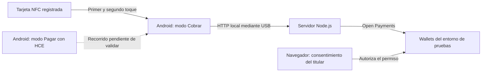

<div align="center">

# Pago al Toque

### Acercar. Escuchar. Confirmar.

Una tarjeta NFC para pagar, un Android para cobrar y Open Payments para conectar el flujo.

**Prototipo de hackatón · Android · Kotlin · Node.js · Open Payments**

[Prototipo visual](https://knob-depth-46768049.figma.site) · [Guía de demostración](NFC/PRUEBA_DATAFONO.md) · [Uso de IA](AI_USAGE.md)

</div>

---

## Una compra cotidiana, una barrera que queremos reducir

Rosa tiene baja visión. Entra a la tienda de José a comprar pan y café. Al pagar, el monto aparece en una pantalla que le cuesta leer.

**«¿Cuánto dice ahí?»**

Antes de confirmar, Rosa quiere comprobar por sí misma cuánto va a pagar. Pago al Toque explora una experiencia en la que puede acercar una tarjeta registrada, escuchar el monto y el nombre del comercio, y volver a acercarla para confirmar.

Queremos contribuir a que más personas puedan decidir sobre sus pagos con autonomía, y que pequeños comercios puedan cobrar desde un Android compatible con NFC.

> Rosa y José son personajes ilustrativos. La accesibilidad de la experiencia es una hipótesis de diseño pendiente de validación con personas con baja visión. El prototipo no ha demostrado accesibilidad integral ni cobertura de todas las discapacidades.

## ¿Qué construimos?

Una aplicación Android con dos modos y un servidor que integra el SDK de Open Payments:

| Modo | Experiencia |
| --- | --- |
| **Cobrar** | El comercio introduce un monto, lee una tarjeta o un celular compatible por NFC y consulta el resultado del cobro. |
| **Pagar** | El usuario administra sus medios de pago y su permiso semanal. El modo celular utiliza HCE y autorización previa con biometría o credencial del dispositivo. |

El recorrido principal de la demo es **tarjeta NFC → Android del comercio**:

1. El titular de la wallet aprueba previamente un permiso con límite semanal.
2. El comercio introduce el monto y solicita el cobro.
3. La persona acerca su tarjeta registrada y escucha el monto y el comercio.
4. Retira la tarjeta y vuelve a acercar el mismo medio para confirmar.
5. El servidor solicita el pago mediante Open Payments y consulta su recepción.
6. La app muestra el resultado y el movimiento en el historial.

La tarjeta identifica un medio registrado: **no almacena dinero**. Durante esa compra, la persona que paga con tarjeta no necesita navegar una app en su propio teléfono; el registro y la autorización inicial siguen siendo necesarios.

## Open Payments en el proyecto

Open Payments participa en el flujo de pago, más allá de la interacción NFC:

| Etapa | Integración |
| --- | --- |
| Autorización previa | Grant interactivo aprobado por el titular, con límite de gasto semanal. |
| Solicitud de cobro | Creación de un `incoming payment` para la wallet del comercio. |
| Cotización | Creación de un `quote` desde la wallet del pagador. |
| Ejecución | Creación de un `outgoing payment` usando el permiso aprobado. |
| Resultado | Consulta del `incoming payment` para comprobar la recepción. |

El servidor Node.js actúa como cliente de Open Payments y conserva las credenciales. La app Android captura la interacción presencial y se comunica con ese servidor. La voz, el doble toque y la biometría son controles de la aplicación, distintos de la autorización de la wallet.

**La demo usa cuentas del mismo test wallet de Interledger.** La integración entre diferentes proveedores compatibles queda pendiente de validación. Las transacciones de demostración pertenecen al entorno de pruebas; no representan una integración bancaria de producción.

## Arquitectura



La configuración actual utiliza `http://localhost:3000` en Android y `adb reverse` para acceder al servidor del computador. Los datos del prototipo se persisten en `NFC/servidor/datos.json`.

| Capa | Tecnologías |
| --- | --- |
| Aplicación | Kotlin, Jetpack Compose y Material 3 |
| Interacción presencial | NFC, Host Card Emulation, voz y vibración |
| Servidor | Node.js, Express y SDK `@interledger/open-payments` |
| Persistencia | Archivo JSON local |
| Pruebas | Node Test Runner y JUnit |

## Estado del prototipo

Según el [contexto documentado al 15 de octubre de 2026](NFC/CONTEXTO_APP.md):

- **Probado por el equipo:** cobros con tarjeta NFC y transacciones en el test wallet, renovación de tokens y permisos.
- **Implementado, pendiente de prueba completa en dos dispositivos:** pago celular → celular mediante HCE.
- **Pendiente:** validación de accesibilidad con usuarios, integración entre proveedores y preparación para producción.

La presencia de una función en el código no implica que todos sus recorridos hayan sido verificados en hardware. Este README no añade una nueva certificación de pruebas.

## Ejecutar en local

### Requisitos

- Node.js y npm. El entorno documentado usa **Node.js 24**.
- Android Studio y el SDK requerido por el proyecto: **compileSdk/targetSdk 37**.
- El proyecto declara **JDK 25** para el daemon de Gradle en `NFC/gradle/gradle-daemon-jvm.properties`. Usar el wrapper incluido.
- Android físico con NFC, cable USB y depuración USB habilitada. El mínimo declarado es **Android 7.0 / API 24**; cada función depende también del hardware.
- Android SDK Platform Tools (`adb`) disponible en la terminal.
- Tarjeta NFC compatible para la demo. El recorrido entre teléfonos requiere un segundo Android con HCE y bloqueo de pantalla configurado.
- Acceso a internet y wallets de prueba para el cliente de Open Payments, el pagador y el comercio.

### 1. Configurar el servidor

Desde la raíz del repositorio:

```bash
cd NFC/servidor
npm ci
```

Copia `.env.example` a `.env` **si todavía no tienes una configuración local** y completa tus propios valores:

```dotenv
APP_WALLET_ADDRESS=https://ilp.interledger-test.dev/tu-wallet-cliente
KEY_ID=tu-key-id
PRIVATE_KEY_PATH=../private.key
PORT=3000
```

| Variable | Uso |
| --- | --- |
| `APP_WALLET_ADDRESS` | Wallet address del cliente que firma las solicitudes. |
| `KEY_ID` | Identificador de la clave registrada para ese cliente. |
| `PRIVATE_KEY_PATH` | Ruta a su clave privada, relativa a `NFC/servidor` o absoluta. |
| `PORT` | Puerto del servidor. Mantener `3000` para usar la app sin cambios. |
| `TIENDA_WALLET_ADDRESS`, `TIENDA_NOMBRE` | Opcionales; usados para migrar la configuración antigua de una única tienda. |

La clave privada debe corresponder a la clave pública registrada para el cliente. Las wallets del pagador y del comercio se vinculan al crear sus cuentas en la aplicación.

**No incluir `.env`, claves privadas ni `datos.json` en la publicación.** La persistencia puede contener tokens y datos de cuentas. El proyecto incluye reglas de exclusión para estos archivos.

Con las credenciales configuradas:

```bash
npm run probar
npm start
```

`npm run probar` comprueba la integración con el entorno externo usando las credenciales configuradas; no es una prueba unitaria. Deja el servidor ejecutándose durante la demo.

### 2. Compilar e instalar Android

Abre `NFC/` en Android Studio y sincroniza el proyecto. Desde esa carpeta:

```bash
# Linux / macOS
bash ./gradlew :app:assembleDebug
```

```powershell
# Windows PowerShell
.\gradlew.bat :app:assembleDebug
```

El APK de prueba se genera en:

```text
NFC/app/build/outputs/apk/debug/app-debug.apk
```

Con el celular conectado por USB, ejecuta desde `NFC/`:

```bash
adb devices
adb -s SERIAL_DEL_CELULAR install -r app/build/outputs/apk/debug/app-debug.apk
adb -s SERIAL_DEL_CELULAR reverse tcp:3000 tcp:3000
```

Sustituye `SERIAL_DEL_CELULAR` por el identificador de tu dispositivo físico. Autoriza la depuración USB en el teléfono. Repite `adb reverse` al reconectar el cable y para cada celular que participe.

### 3. Preparar una compra

1. Crea o recupera las cuentas del pagador y del comercio con sus wallet addresses de prueba.
2. Registra la tarjeta en la cuenta del pagador.
3. Aprueba el permiso semanal en el navegador con la sesión del **titular de esa wallet**.
4. En el Android del comercio, selecciona **Cobrar** e introduce un monto pequeño.
5. Acerca, retira y vuelve a acercar la misma tarjeta.
6. Comprueba el resultado en la app y en el test wallet.

La [guía de demostración](NFC/PRUEBA_DATAFONO.md) detalla la preparación de cuentas, los recorridos y los errores frecuentes. Para un video de demo, muestra el permiso, la solicitud, la confirmación y el resultado; deja escuchar la voz de la aplicación.

## Pruebas

Pruebas unitarias del servidor, desde `NFC/servidor/`:

```bash
npm test
```

Pruebas unitarias Android, desde `NFC/`:

```bash
bash ./gradlew :app:testDebugUnitTest
```

En Windows, usa `.\gradlew.bat :app:testDebugUnitTest`.

Las pruebas automatizadas cubren lógica como montos, medios de pago y protocolo HCE. No reemplazan las pruebas físicas de NFC, voz, consentimiento y pago de extremo a extremo.

## Alcance y próximos pasos

- **Conectividad:** la tarjeta no requiere internet; el teléfono que cobra y el servidor sí necesitan conexión para completar el flujo.
- **Despliegue:** el APK puede instalarse directamente para pruebas. Su instalación por sí sola no publica el servidor ni elimina la dependencia del computador en esta configuración.
- **Accesibilidad:** validar junto con personas con baja visión el registro, la comprensión del cobro, la ubicación del lector, el ruido ambiental, la privacidad del audio y la confirmación final.
- **Información financiera:** el disponible semanal es el restante del permiso, no el saldo de la wallet. El historial no representa todos los movimientos externos de la cuenta.
- **Seguridad:** NFC y el doble toque no prueban por sí solos la autenticidad del medio. Antes de un uso productivo se requiere reforzar autenticación, protección contra clonación y repetición, gestión de secretos y persistencia.
- **Compatibilidad:** no es una terminal certificada para tarjetas bancarias ni una integración comprobada con todos los bancos o wallets.

## Estructura del repositorio

```text
.
├── NFC/
│   ├── app/                  # Aplicación Android y pruebas
│   ├── servidor/             # API, Open Payments y pruebas Node.js
│   ├── gradle/               # Configuración y wrapper
│   ├── reports/              # Análisis de arquitectura
│   ├── research_notes/       # Notas sobre Open Payments
│   ├── CONTEXTO_APP.md        # Estado documentado y decisiones
│   └── PRUEBA_DATAFONO.md     # Guía de demostración
├── prompts/                  # Prompts organizados por etapas
├── AI_USAGE.md               # Declaración de uso de IA
└── README.md
```

## Documentación y diseño

- [Guía de pruebas de pago](NFC/PRUEBA_DATAFONO.md)
- [Pruebas de NFC](NFC/PRUEBAS_NFC.md)
- [Contexto técnico](NFC/CONTEXTO_APP.md)
- [Arquitectura de Open Payments](<NFC/reports/Arquitectura Open Payments Pago al Toque.md>)
- [Prototipo visual](https://knob-depth-46768049.figma.site)
- [Referencia del wireframe](Wireframe_Link.txt)
- [Uso de IA durante el desarrollo](AI_USAGE.md)
- [Prompts del proyecto](prompts/)

El prototipo visual ilustra la interfaz; la demostración de pagos requiere la aplicación Android y el servidor.

---

**Pago al Toque — pagos abiertos para las compras de todos los días.**
